# Tablero Maestro de Seguimiento del Portafolio

Centro de control para hacer seguimiento a **las dos divisiones del portafolio**, separando con total claridad el negocio **Avícola activo (foco actual: `AV-1` y `AV-2`)** de los proyectos industriales hermanos (**`IND-ALIM`** Planta de Concentrados e **`IND-PALMA`** Biorrefinerías de Palma + Puente Biotecnológico Coopar).

---

## Vista General de los Frentes del Portafolio

```mermaid
flowchart LR
    subgraph AV1["AV-1 · Plan Financiero y Simulador Avícola (42 Días)"]
        FB_1["Precios Reales Cúcuta/B/manga vs. Web"]
        FB_2["Simulador 800 aves: Comercial ($7.488/kg) vs. Propio ($7.014/kg)"]
        FB_3["Proyección Real 12 Meses ($40,27M util. | Pico $15,11M)"]
    end

    subgraph AV2["AV-2 · Operación Activa en Granja (Lotes 1 a 3 · 6 Semanas)"]
        C1_1["Lote 1: 600 pollos (13-nov) @ $4.500 -> 24-dic"]
        C1_2["Lote 2: 800 pollos (+10d: 23-nov) -> 03-ene @ $3.200"]
        C1_3["Lote 3: 800 pollos (05-dic, 42d) -> 15-ene @ $3.200"]
        C1_4["Auditoría Térmica 2.200 aves (4,0 t) + Pico Caja $31,21M"]
    end

    subgraph IA["IND-ALIM · Planta de Concentrado Harina (RL L09)"]
        F1_1["1.1 Formulación y RL L09 ($1.825/kg planta)"]
        F1_3["1.2 Proveedores Maíz/Soya/Premix"]
        F1_4["1.4 Línea Molienda VFD + Mezcla"]
        F1_5["1.5 Registro ICA Autoconsumo/Comercial"]
    end

    subgraph PUENTE["PROTOTIPO PUENTE EN PLANTA COOPAR (Ing. Billy Ramírez / Ing. Mauricio Bonilla)"]
        PR_1["Fase A (4,5 kg lab) -> Compuerta Go/No-Go -> Fase B (30 kg piloto externo)"]
        PR_2["Análisis bromatológico (PC, TCA, FDN, AA, Aflatoxinas) y prueba en pollos"]
    end

    subgraph IP["IND-PALMA · Biorrefinerías de Palma 2 y 4 t/h"]
        F2_1["1. Ingeniería Conceptual 2 y 4 t/h"]
        F2_2["2. Módulo 4 Subproductos Cero-Residuos"]
        F2_3["3. Modelo Financiero y CAPEX"]
        F2_4["4. Esquema Legal EPC + 15% Equity"]
        F2_5["5. Rueda con Inversionistas / Palmicultores"]
    end

    IA -->|"F2 L09 ($73k/b + $3,8k flete/pigmento) alimenta"| AV1
    AV1 -->|"Benchmarks y flujo de caja guían"| AV2
    IA -->|"Consume aceite crudo y prueba FPKC"| PUENTE
    PUENTE -->|"Muestras reales respaldan"| IP
```

---

## PROYECTO AVÍCOLA 1 (`AV-1`) · Plan Financiero y Simulador de Rentabilidad Avícola

* **Carpeta:** [`avicola_01_plan_financiero/`](avicola_01_plan_financiero/)
* **Excel Dinámico (`0` errores COM):** [`AV1_Plan_Financiero_Avicola.xlsx`](avicola_01_plan_financiero/AV1_Plan_Financiero_Avicola.xlsx)
* **Resumen Ejecutivo:** [`Resumen_Ejecutivo_AV1.md`](avicola_01_plan_financiero/Resumen_Ejecutivo_AV1.md)

| Frente | Estado | Dato Base Auditado | Próxima Tarea Concreta (Checklist) | Meta / KPI (Verificado COM) |
| :--- | :---: | :--- | :--- | :--- |
| **AV-1.1 Supuestos y Precios Cúcuta/B/manga** | 🟢 Listo | Precios reales Solla (`$106,5k / $96,2k / $93,4k`), pollito local `$4.500` vs. B/manga `$3.200`, sacrificio `$1.500/ave`, insumos `$1.325/ave`. | - [ ] Actualizar en celdas amarillas facturas reales de cama/gas/vacunas y flete/empaque post-sacrificio. - [ ] Actualizar precio mayorista Cúcuta dic-2026 / ene-2027. | Trazabilidad `100 %` real; rendimiento seco Ross exacto `74,75%` (`d42`). |
| **AV-1.2 Simulador por Lote (`800` aves · `42d`)** | 🟢 Auditado | Cascada **Crianza Vivo → Beneficio → Canal (`~2,47 kg` c/m)**: Comercial vs. Propio `d22+` (`+$3.800/b` flete/pigmento + `+3,8%` consumo) vs. Ref. Lote 1 (`600`). | - [ ] Definir si el cliente acepta `~2,47 kg` c/menud. a 42d o exige `>=2,70 kg` (`45d`). - [ ] Validar penalización harina vs. pellet (`3,8%` vs. `6,5%`). | Comercial: **`$7.488/kg`** canal (**`$7.692.289`** util., `34,9%`). Propio `d22+`: **`$7.014/kg`** canal (**`$8.601.089`** util., **`+$908.800/lote`**). |
| **AV-1.3 Proyección Anual (`6` Lotes · `12` Meses)** | 🟢 Auditado | Carga los **`12,0` meses reales (`$11,0M/año`)** con consumo `Consumo Pollo` (`4.445 g/ave` d42) y separa flujo anual de Capital Pico (`1` ciclo rotativo). | - [ ] Confirmar si se opera a `1` lote rotativo (`$15,11M` pico) o traslapado multi-lote (`AV-2`). | `11.025,0 kg` canal/año · Utilidad neta **`$40.274.309 COP/año`** (**`266,6%`** ROI anual s/Pico **`$15,11M`**). |

---

## PROYECTO AVÍCOLA 2 (`AV-2`) · Operación Activa en Granja — Lotes 1 a 3 (Nov 2026 – Ene 2027)

* **Carpeta:** [`avicola_02_operacion_granja/`](avicola_02_operacion_granja/)
* **Excel Dinámico (`0` errores COM):** [`AV2_Operacion_Granja_Lotes_1_a_3.xlsx`](avicola_02_operacion_granja/AV2_Operacion_Granja_Lotes_1_a_3.xlsx) (`7` hojas)
* **Plan & Auditoría Forense:** [`Plan_Ejecutivo_y_Auditoria_AV2.md`](avicola_02_operacion_granja/Plan_Ejecutivo_y_Auditoria_AV2.md)

| Frente | Estado | Dato Base Auditado | Próxima Tarea Concreta (Checklist) | Meta / Fecha Hito (Verificado COM) |
| :--- | :---: | :--- | :--- | :--- |
| **AV-2.1 Lote 1 (`600` Ross 308 AP · `42d`)** | 🟢 Alojada `2026-11-13` | Pollito **`$4.500/ave`** (`$2,70M`); calculadora 6 sem = `4.445 g/ave` (`67` ppto. / `68` bodega vs `54` iniciales = **`+13` b. / `+$1.228.200`**); sacrificio `$873k`. | - [ ] Registrar bitácora (Hoja 4) y pesajes semanales `d7..d42` (Hoja 5). - [ ] Comprar **`+5` bultos de Nutrepollo** antes de terminar Semana 3 y `+8` a `+9` bultos Broiler Dorado. | Salida `42d`: **`2026-12-24`** (`~2,47 kg` c/m) · Costo **`$6.303/kg` vivo · `$8.247/kg` canal** · Util. **`$4.677.666`** (`28,3%`). |
| **AV-2.2 Lote 2 (`800` Pollos, `+10d` · `42d`)** | 🟠 Por encasetar `2026-11-23` | Proveedor directo Bucaramanga **`$3.200/ave`** (`$2.560.000`, `-$140k` menos que 600 a `$4.500`); `89` bultos; sacrificio `$1.500/ave` (`$1.164k`). | - [ ] Confirmar entrega en B/manga e instalar división térmica + equipo para Lote 2 antes del `23-nov`. - [ ] Digitar **m² útiles reales** en `1_Plan_3_Lotes_y_Capacidad!B42` (mínimo `275–300 m²`). | Salida `42d`: **`2027-01-03`** · Costo **`$5.677/kg` vivo · `$7.488/kg` canal** · Util. **`$7.692.289`** (`34,9%`). |
| **AV-2.3 Lote 3 (`800` Pollos, Meta `15-ene` · `42d`)** | 🟡 Reservar `2026-11-25` | Ingreso **`2026-12-05`** (`04-dic` si ayuna `10-12 h` antes de sacrificio temprano) -> salida **`2027-01-15`**; pico **`2.200` aves (`3,98 t`)** del `05-dic` al `24-dic`. | - [ ] Reservar incubadora B/manga máximo **`25-nov`**.  - [ ] Asegurar caja líquida **`$31.212.600`** (pico Sem 7 antes de cobrar Lote 1 el `24-dic`) y cortinas/criadoras (`4` criadoras, `~80` comederos). | Consolidado 3 Lotes: **`$20.062.243`** util. · Caja final post 4m arriendo (`$3,0M`): **`+$19.312.243`**. |

---

## PROYECTO HERMANO `IND-ALIM` · Planta de Concentrado para Pollo en Harina (`RL L09`)

* **Carpeta:** [`docs/`](docs/), [`modelo/`](modelo/) y [`simulacion_rl/ciclo_01/`](simulacion_rl/ciclo_01/)
* **Modelo Excel:** [`modelo/Modelo_Costeo_Concentrados.xlsx`](modelo/Modelo_Costeo_Concentrados.xlsx) (pestaña `Auditoria_Realista` incluye paridad real contra Solla `$93.400/bulto`)

| Frente | Estado | Entregable / Documento Base | Próxima Tarea Concreta (Checklist) | Meta / KPI |
| :--- | :---: | :--- | :--- | :--- |
| **IA-1 Producto, RL L09 y Calibración** | 🟢 Calibrado | [02_producto_y_formulacion.md](docs/02_producto_y_formulacion.md) [resultados_rl.md](simulacion_rl/ciclo_01/resultados_rl.md) | - [ ] Validar cotizaciones locales de soya integral extruida QA, arroz partido El Zulia y harina de vísceras ICA. - [ ] Mandar a analizar el primer lote de maíz y soya. | `L09` puesta en planta `$1.825/kg`; en galpón `14,6 %` ahorro neto real vs. Solla `$93.400` incl. flete+pigmento+harina. |
| **IA-2 Abastecimiento** | 🔴 Por cotizar | [04_abastecimiento_proveedores.md](docs/04_abastecimiento_proveedores.md) | - [ ] Cotizar maíz y torta de soya 46 % (*Seaboard, Hacienda, Italcol*). - [ ] Cotizar premix, L-Valina, enzimas NSP+Fitasa (*Carval, Provimi, DSM*). - [ ] Fijar precio de aceite crudo y expeller PKC con proveedor externo (ej. Oleonorte). | Actualizar precios reales en `ingredientes_auditados.json`. |
| **IA-3 Validación Comercial** | 🟡 En diseño | [01_modelo_de_negocio.md](docs/01_modelo_de_negocio.md) | - [ ] Definir en hoja `3_Impacto_Alimento_Propio` de `AV-2` ensayo piloto F2 cuando planta opere. - [ ] Encuestar 15–20 granjas en radio de 100 km. | Medir FCR harina VFD ($\approx 3,8\text{–}6,5\text{ \%}$) y asegurar demanda $\ge 45,2\text{ t/mes}$ (PE RL). |
| **IA-4 Planta Industrial (Molienda Gruesa + VFD)** | 🟡 Concepto | [03_planta_industrial.md](docs/03_planta_industrial.md) | - [ ] Cotizar molino con variador VFD/zaranda gruesa, mezcladora de 1 t y tanque de aceite calentado ($45\text{–}55\ ^\circ\text{C}$). | Granulometría maíz 1.200–2.000 µm; CV mezcla $< 10\text{ \%}$. |
| **IA-5 Regulación ICA y Calidad** | 🟡 Ruta clara | [05_regulacion_calidad.md](docs/05_regulacion_calidad.md) | - [ ] Vincular asesor técnico (MV / Zootecnista). - [ ] Inscribir planta en SimplifICA (Autoconsumo $\rightarrow$ Comercial). | Registro ICA Res. 061252/2020 aprobado. |

---

## PROYECTO HERMANO `IND-PALMA` · Biorrefinerías de Palma a Pequeña Escala (2 y 4 t RFF/h + *Equity*)

* **Carpeta:** [`proyecto_extractora/`](proyecto_extractora/)
* **Modelo Excel:** [`proyecto_extractora/Modelo_Extractora_2_y_4_th.xlsx`](proyecto_extractora/Modelo_Extractora_2_y_4_th.xlsx)

| Frente | Estado | Entregable / Documento Base | Próxima Tarea Concreta (Checklist) | Meta / KPI |
| :--- | :---: | :--- | :--- | :--- |
| **2.1 Ingeniería y Dimensionamiento (2 y 4 t/h)** | 🟢 Estructurado | [01_dimensionamiento_2_y_4_th.md](proyecto_extractora/01_dimensionamiento_2_y_4_th.md) | - [ ] Solicitar cotizaciones de línea modular 2 t/h (prensa doble tornillo, palmistería, caldera, *tricanter*). - [ ] Dibujar *layout* general en 2 ha (2 t/h) y 3 ha (4 t/h). | OER $\ge 21\text{ \%}$; diseño modular $1\times 2\text{ t/h} \rightarrow 2\times 2\text{ t/h}$. |
| **2.2 Subproductos (Estudio FES en Coopar)** | 🟢 Paquete v3.0 listo | [Protocolo_Estudio_Piloto_Coopar_Ing_Billy_Ramirez.md](proyecto_extractora/estudio_coopar/Protocolo_Estudio_Piloto_Coopar_Ing_Billy_Ramirez.md) [Herramienta_Estudio_Coopar_FES.xlsx](proyecto_extractora/estudio_coopar/Herramienta_Estudio_Coopar_FES.xlsx) | - [ ] Entregar protocolo v3.0 y Excel al **Ing. Billy Ramírez (Director de Planta, Coopar)**. - [ ] Comprar $2,5\text{ kg}$ (Fase A) de **Torta de Palmiste fresca** y moler a $<2,5\text{ mm}$. - [ ] Correr **Fase A (4,5 kg = 3 bandejas de 1,5 kg)** en cuarto auxiliar de Coopar; si cumple metas, activar **Fase B (30 kg húmedos $\rightarrow 14,6\text{ kg}$ secos)** con 1 bidón de 20 L de lodo. | PC $21\text{–}23\text{ \%}$ base comercial ($23\text{–}25\text{ \%}$ MS); Proteína Verdadera TCA $\ge +4\text{ pts}$ vs T0; Fibra $-20\text{ a }-32\text{ \%}$; Aflatoxinas $<10\text{ ppb}$. *(Carbón de cuesco ya validado por el Ing. Mauricio Bonilla).* |
| **2.3 Modelo Financiero (2 y 4 t/h)** | 🟢 Funcional | [Modelo_Extractora_2_y_4_th.xlsx](proyecto_extractora/Modelo_Extractora_2_y_4_th.xlsx) | - [ ] Ajustar CAPEX con cotizaciones reales de maquinaria. - [ ] Validar precio local de compra de RFF y venta de carbón/abono. | Payback $< 2,5\text{ años}$; subproductos aportando $>40\text{ \%}$ de la utilidad neta. |
| **2.4 Estructuración Legal y Participación (*Equity*)** | 🟢 Estructurado | [04_estructuracion_legal_y_comercial_equity.md](proyecto_extractora/04_estructuracion_legal_y_comercial_equity.md) | - [ ] Redactar borrador de Term Sheet (Opción A: 15 % *Sweat Equity*; Opción B: Co-inversión; Opción C: *Earn-out*). | Conservar **10 % a 20 % de acciones** en cada planta vendida. |
| **2.5 Prospección de Inversionistas / Núcleos Palmeros** | 🔴 Por iniciar | [02_modelo_negocio_inversionista.md](proyecto_extractora/02_modelo_negocio_inversionista.md) | - [ ] Identificar 3 a 5 grupos de palmicultores que sumen 450–1.000 ha lejos de extractoras grandes (Norte de Santander / Sur del Cesar / Magdalena Medio). | Cerrar primer acuerdo de pre-factibilidad con un núcleo palmero. |
