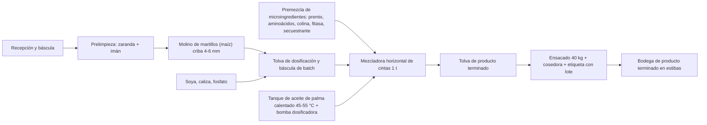

# 03 · Planta industrial (harina / mash)

## 1. Criterios de diseño

- **Sin peletizadora ni vapor** en las fases 0–1. Proceso: moler → pesar → mezclar → agregar aceite → empacar.
- **Capacidad fase 1:** 1,5–2 t/h nominales. En un turno de 8 h y 22 días eso da 250–350 t/mes, de 5 a 7 veces el punto de equilibrio, lo que permite crecer sin invertir de nuevo.
- **Por lotes (batch) de 1 t:** es más simple, más exacto con microingredientes y más fácil de trazar que un sistema continuo.
- **Diseño pensado para una fase 2** con migaja/pellet: dejar espacio y acometida eléctrica.

## 2. Flujo de proceso

**Ciclo de mezcla:** carga 2–3 min, mezcla en seco 2–3 min, aspersión de aceite + 2–3 min, descarga 1–2 min ≈ **8–10 min/batch → 6 batch/h máximo**. El molino suele ser el cuello de botella: dimensionarlo para ≥ 1,5 t/h de maíz.

## 3. Puntos técnicos críticos

| Tema | Por qué importa | Solución |
|---|---|---|
| **El aceite de palma es semisólido** | Funde entre ≈ 33 y 40 °C. En Cúcuta la temperatura ambiente no basta para mantenerlo líquido y homogéneo, y no se puede dosificar bien. | Tanque aislado con **resistencia o serpentín de agua caliente**, entre 45 y 55 °C (no pasar de 60 °C para no oxidarlo), con agitación. Calentar solo el consumo del día. Bomba de engranajes, medidor másico o báscula, y boquillas sobre la mezcladora. |
| **Granulometría ("mash grueso", no polvo)** | En la industria se llama "harina" por traducción de *mash*, pero el pollo rechaza el polvo fino: se pega al pico, baja el consumo y empeora la conversión. Si queda dispareja, el ave escoge el maíz grueso y deja los finos con vitaminas y aminoácidos. | **Opción ideal:** **molino de rodillos**, que parte el maíz de forma pareja con muy poco polvo y gasta 30–50 % menos energía. **Opción con molino de martillos:** criba amplia (**6–8 mm**) y **variador de frecuencia (VFD)** para bajar las RPM. Meta Aviagen para harina gruesa: GMD del cereal **1.200–2.000 µm** (~25 % > 3 mm, ~25 % de 2–3 mm, ~25 % de 1–2 mm y < 25 % menor a 1 mm). Además, el **3,6–4,0 % de aceite de palma** pega los finos (premix, aminoácidos, minerales) a las partículas gruesas y evita que se separen. |
| **Microingredientes** (3–7 kg/t) | Un error en el premix o la metionina arruina el lote | Balanza de precisión (± 1 g). **Premezcla** con 10–20 kg de maíz molido antes de la mezcladora. Registro firmado por batch. |
| **Homogeneidad** | Una mezcladora mal dimensionada o sobrecargada no mezcla parejo | Prueba de CV con trazador al instalar (CV < 10 %). No cargar más del 100 % del volumen nominal. |
| **Polvo** | Riesgo laboral, pérdida de producto, riesgo de explosión de polvo de grano | Ciclón o filtro de mangas en el molino, puesta a tierra, aseo diario, motores cerrados |
| **Plagas y humedad** | Gorgojo, roedores, hongos y aflatoxinas | Piso de concreto, estibas a 50 cm de las paredes, mallas, rotación FIFO, programa de control de plagas contratado |

## 4. Equipos fase 1 (para cotizar)

| Equipo | Especificación orientativa |
|---|---|
| Báscula de plataforma | 1–2 t (la camionera puede esperar) |
| Zaranda de prelimpieza + imán | 2–3 t/h |
| Molino de martillos | 30–40 HP, ≥ 1,5 t/h de maíz con criba de 5 mm, con ciclón |
| Transportadores | Sinfines y/o elevador de cangilones |
| Tolva báscula de batch | 1 t, celdas de carga |
| **Mezcladora horizontal de doble cinta** | 1 t (≈ 2 m³), con boquillas de líquido y compuerta de descarga rápida |
| Sistema de aceite | Tanque de 2–5 m³ aislado y calentado, bomba, medidor, filtro |
| Balanza de precisión | 0–30 kg ± 1 g |
| Ensacadora | Tolva báscula de 40 kg + cosedora de banda o portátil |
| Laboratorio básico | Humedímetro, tamices, lector de tiras de aflatoxina, estufa |
| Eléctrico | Acometida **trifásica** de ≈ 60–80 kVA, tablero con arrancadores |

**Fase 0 (piloto en granja):** mezcladora vertical de 500 kg, molino pequeño de 10–15 HP y aceite calentado en baño de agua. Alcanza para el autoconsumo y para validar el producto antes de la inversión grande.

## 5. Bodega y distribución física (fase 1)

Área orientativa **450–600 m²**, techo alto y ventilado:

| Zona | % área | Nota |
|---|---|---|
| Materias primas (maíz y soya en bulto o big-bag) | 40 % | Inventario de 2–3 semanas. Silo de 100–200 t de maíz cuando se superen ≈ 150 t/mes. |
| Proceso (molino, mezcladora, ensacado) | 20 % | Separado de las bodegas por muro o malla |
| Producto terminado | 25 % | Despacho FIFO, lejos del ingreso de materias primas |
| Microingredientes (bodega con llave), laboratorio, oficina, baños | 15 % | Exigido por las BPM del ICA |

**Ubicación:** comparar (a) **junto a la extractora**, que da aceite sin flete y biomasa para la fase 2, con (b) **cerca de los clientes y de la vía principal**. Requisitos en ambos casos: uso de suelo compatible con el POT, acceso para tractomula, agua, energía trifásica y concepto ambiental (CORPONOR) por emisiones de polvo.

## 6. Fase 2 (migaja/pellet con biomasa)

Si el mercado pide pellet, la ventaja local es la **fibra y el cuesco de palma** como combustible de una caldera pequeña para el vapor de acondicionamiento (80–85 °C). Con 4 % de aceite, conviene **agregar parte del aceite después del pellet (coating)** para no dañar la durabilidad. También abriría la puerta al **iniciador en migaja**, el producto que hoy se descarta.
