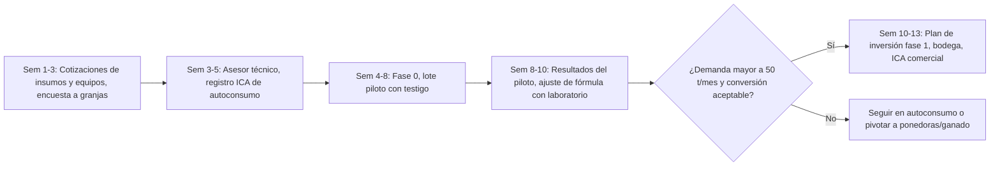

# 06 · Oportunidades de mejora (priorizadas)

Impacto: 🔴 alto · 🟡 medio · 🟢 bajo. Esfuerzo: S (semanas) · M (meses) · L (fase 2).

## A. Modelo de negocio

| # | Oportunidad | Impacto | Esfuerzo | Comentario |
|---|---|:-:|:-:|---|
| A1 | **Validar la demanda antes de invertir**: encuesta a 15–20 granjas (aves por lote, marca, precio, ¿aceptan harina?) | 🔴 | S | El punto de equilibrio son ≈ 32 lotes de 500 aves por mes. Sin clientes comprometidos no hay negocio. |
| A2 | **Piloto en la granja del hermano** con grupo testigo (comercial frente a harina propia) | 🔴 | S | Convierte el supuesto de "−5 % de conversión" en un dato real, que es el mejor argumento de venta. |
| A3 | **Programa completo con aliado**: distribuir iniciador peletizado de un tercero junto con nuestra harina | 🔴 | S | Quita la objeción de "tengo que comprar dos marcas" sin invertir en peletizadora. |
| A4 | **Ponedoras en harina** como segunda línea | 🔴 | M | Las ponedoras **comen harina durante todo su ciclo**, la demanda es continua y el equipo es el mismo. Santander y Norte de Santander tienen una avicultura de postura importante (validar el tamaño local). Requiere más Ca (caliza gruesa) y pigmentante. |
| A5 | **Suplemento para ganado con torta de palmiste** | 🟡 | M | Aprovecha lo que se descartó para pollo. La torta sirve en rumiantes y la ganadería regional es grande. Mismo molino y mezcladora. |
| A6 | Servicio técnico como diferenciador (visitas, registro de conversión del cliente) | 🟡 | S | Las marcas grandes no atienden bien al productor pequeño. |
| A7 | Precio indexado al maíz y la soya y política de crédito corta | 🟡 | S | Protege el margen de 16 % frente a la volatilidad. |
| A8 | Maquila para integraciones medianas (su fórmula, nuestra planta) | 🟢 | M | Llena la capacidad ociosa sin riesgo comercial. |

## B. Producto

| # | Oportunidad | Impacto | Esfuerzo | Comentario |
|---|---|:-:|:-:|---|
| B1 | **Fitasa** (500 FTU/kg) | 🔴 | S | ≈ −29.000 COP/t ya calculado. Con la matriz completa del fabricante (energía y aminoácidos) el ahorro sube. |
| B2 | **Control de aflatoxinas + secuestrante** | 🔴 | S | Clima caliente y maíz almacenado. Un lote contaminado daña la reputación. Ya va en la fórmula base. |
| B3 | **Un solo SKU al lanzamiento** | 🟡 | S | Menos inventario y un solo registro ICA. Simple para el cliente. |
| B4 | Cerrar la brecha de **valina e isoleucina** (L-valina o +1–2 % de soya) | 🟡 | S | Las fórmulas del chat quedaban en 95 % de valina. |
| B5 | Definir **anticoccidial + versión de retiro** con el asesor | 🔴 | S | Sin anticoccidial, el cliente ve coccidiosis y culpa al alimento. |
| B6 | Versión **"dorada"** con xantofilas si el mercado local paga por la piel amarilla | 🟡 | M | El betacaroteno del aceite rojo casi no pigmenta la piel. |
| B7 | Comunicar la grasa alta (≈ 6,8 % EE) y "energía de palma fresca" como atributo | 🟢 | S | Se diferencia en la etiqueta. Proteína cruda moderada, compensada con aminoácidos. |
| B8 | Pedir a la extractora análisis de **ácidos grasos** del aceite (no solo AGL) | 🟢 | S | Afina la EM real del aceite (supuesta en 8.000 kcal/kg). |
| B9 | **I+D Bio-conversión en la extractora (POME + subproductos de palma)** | 🔴 | L | Cuatro rutas evaluadas: **(1) Hongos – Fermentación en Estado Sólido (FES)** de torta de palmiste humedecida con POME (*Rhizopus / Aspergillus*): sube la proteína del palmiste de ~16 % a 24–30 %, rompe la fibra (mananos) y permite incluir 10–15 % en pollo sin centrífugas ni secado masivo; **(2) Microalgas (*Spirulina/Chlorella*) o *Lemna*** en POME clarificado (30–70 % PC + xantofilas para pigmentar piel); **(3) Lombricultura (*Eisenia fetida*)** en raquis + lodos de POME (60–70 % PC + humus para cultivo de palma, limitada en escala por mano de obra y 83 % de humedad); **(4) Mosca Soldado Negra**. |

## C. Planta industrial

| # | Oportunidad | Impacto | Esfuerzo | Comentario |
|---|---|:-:|:-:|---|
| C1 | **Tanque de aceite calentado** con dosificación por peso | 🔴 | S | El aceite de palma no es líquido a temperatura ambiente. Sin esto, el aceite se dosifica mal y queda en grumos. |
| C2 | **Fase 0 de bajo costo** antes de la planta formal | 🔴 | S | Se aprende el proceso y se valida el mercado arriesgando poco capital. |
| C3 | Ubicar la planta **cerca de la extractora** si la logística hacia los clientes lo permite | 🟡 | M | Aceite sin flete y biomasa para la fase 2. |
| C4 | **Caldera de biomasa** (fibra/cuesco) para migaja/pellet en la fase 2 | 🔴 | L | Quita la desventaja de la harina con energía casi gratis y abre el iniciador. |
| C5 | Molino dimensionado como cuello de botella (≥ 1,5 t/h) y criba gruesa | 🟡 | S | Mejor granulometría para harina y menos kWh/t. |
| C6 | Silo de maíz de 100–200 t al pasar de 150 t/mes | 🟡 | M | Permite comprar a granel, más barato que en bulto, y reduce la manipulación. |
| C7 | Prueba de **homogeneidad (CV)** al arrancar | 🟡 | S | Es barata y valida la mezcladora y el tiempo de mezcla. |
| C8 | Paneles solares para la carga diurna del molino | 🟢 | M | La energía es poca en harina, pero la radiación de Cúcuta es alta. |

## Hoja de ruta sugerida (próximos 90 días)

