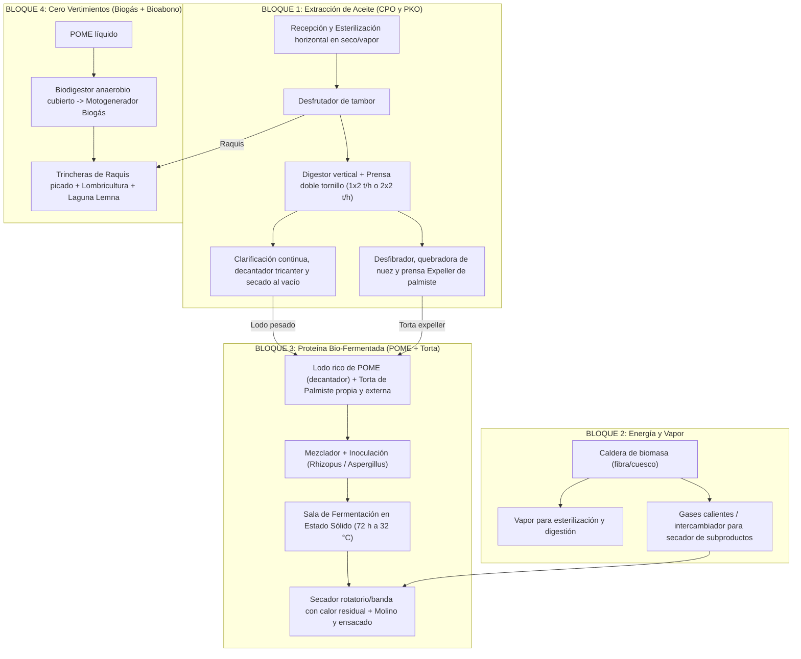

# 01 · Dimensionamiento Técnico y Balances: Plantas de 2 y 4 t RFF/h

## 1. Filosofía de Diseño Modular (2 t/h $\rightarrow$ 4 t/h)

* **Módulo Base (2 t RFF/h):** Es la unidad mínima industrialmente eficiente con extracción continua por prensa de doble tornillo, palmistería integrada y caldera de biomasa.
* **Módulo Doble (4 t RFF/h):** Se configura con **dos líneas de prensado y palmistería de 2 t/h en paralelo** compartiendo recepción, caldera, clarificación y planta de subproductos.
  * **Ventaja para el inversionista:** Puede arrancar construyendo la nave para 4 t/h con **una sola línea instalada (2 t/h)** y montar la segunda línea con el propio flujo de caja del negocio, además de no detener nunca la planta al 100 % durante mantenimientos.

---

## 2. Balance de Masa y Producción Mensual (2 t/h vs. 4 t/h)

Base operativa: **350 horas efectivas/mes** (14 h/día × 25 días) en temporada media; en pico de cosecha puede subir a 450–500 h/mes. Balance referenciado para **100 % fruto *Elaeis guineensis*** (productividad de cultivo de referencia: **18 t RFF/ha/año**; si se procesa fruto Híbrido OxG, la fracción de almendra/PKO se reduce aprox. a la mitad).

| Indicador / Corriente de Proceso | Rendimiento (% sobre RFF) | **Planta 2 t RFF/h** (700 t RFF/mes) | **Planta 4 t RFF/h** (1.400 t RFF/mes) | Destino y Valorización |
| :--- | :---: | :---: | :---: | :--- |
| **Área de palma requerida** | — | **~465 ha** | **~930 ha** | Fincas propias del inversionista + aliados en radio < 25 km |
| **1. Aceite Crudo de Palma (CPO)** | **21,0 %** | **147,0 t/mes** | **294,0 t/mes** | Venta a refinerías / biocombustibles / plantas de concentrado |
| **2. Aceite de Palmiste (PKO)** *(expeller 1 etapa)* | **1,7 – 1,8 %** | **12,0 – 12,6 t/mes** | **24,0 – 25,2 t/mes** | Venta a industria cosmética, jabonera o confitería (precio premio) |
| **3. Torta de Palmiste Expeller** | **2,7 – 2,8 %** | **19,0 – 19,6 t/mes** | **38,0 – 39,2 t/mes** | Pasa al **Módulo de Bio-Fermentación (FES)** con POME |
| **4. Efluente Líquido (POME)** | **600 L/t** | **420 m³/mes** (~19 t sólidos) | **840 m³/mes** (~38 t sólidos) | Lodo espeso a FES; líquido a Biodigestor $\rightarrow$ Algas/*Lemna* y Compost |
| **5. Fibra de mesocarpio** | **13,0 %** | **91,0 t/mes** | **182,0 t/mes** | Combustible base de caldera; en 2 t/h se mezcla con **~30–35 % del cuesco** si no hay pre-secado de fibra |
| **6. Cuesco libre para Pirólisis** *(neto tras caldera)* | **~4,0 %** *(6,0 % bruto)* | **28 – 30 t/mes** *(42 t bruto)* | **56 – 60 t/mes** *(84 t bruto)* | **Pirólisis / Carbonización $\rightarrow$ Carbón de Cuesco / Biochar** (~9,5 t/mes en 2 t/h y ~19 t/mes en 4 t/h) |
| **7. Raquis / Tusa vacía (EFB)** | **22,0 %** | **154,0 t/mes** | **308,0 t/mes** | Picado/prensado + POME + ceniza $\rightarrow$ **Bioabono / Lombricultura** |

---

## 3. Dimensionamiento de los 4 Bloques de Proceso

### Detalle del Bloque 3 (El diferenciador del proyecto): Planta de Proteína Bio-Fermentada
* **Capacidad con solo torta propia:** ~18 t/mes (en 2 t/h) y ~36 t/mes (en 4 t/h) de **Palmiste Bio-Fermentado (21–24 % Proteína Cruda en base comercial / 23–25 % en MS)** tras optimización con fuentes nitrogenadas y balance de masa real.
* **Capacidad ampliada (Aprovechando todo el lodo rico del POME y el calor sobrante de chimenea):**
  * Como a la planta le sobran sólidos de POME y calor de caldera, el módulo FES puede recibir **torta de palmiste comprada a terceros o salvado de arroz/maíz regional**, produciendo **60 t/mes (en 2 t/h) o 120 t/mes (en 4 t/h)** de alimento proteico en bultos de 40 kg para ganadería, porcicultura y avicultura.
* **Equipos clave para recuperar sólidos y aceite del POME:**
  * En lugar de mandar todo el lodo a lagunas abiertas, instalar un **Decantador Centrífugo de 3 Fases (*Tricanter*)** en la clarificación. Este equipo separa al instante: (1) aceite recuperado, (2) **torta húmeda de lodo de POME (*decanter cake* con 30 % de materia seca y 12–14 % de proteína)** lista para entrar directo a la fermentación con hongos sin exceso de agua, y (3) agua clarificada para el biodigestor.

---

## 4. Requerimientos de Infraestructura y Personal

| Recurso | Planta 2 t RFF/h | Planta 4 t RFF/h |
| :--- | :---: | :---: |
| **Área de terreno total** (incluyendo compostaje y biodigestor) | 1,5 – 2,0 hectáreas | 2,5 – 3,5 hectáreas |
| **Nave industrial techada** (extracción + palmistería + FES) | ~600 m² | ~950 m² |
| **Potencia eléctrica instalada** (suplida en >70 % por biogás/biomasa) | ~90 – 110 kW | ~160 – 200 kW |
| **Consumo de agua** | ~0,7 m³ / t RFF | ~0,7 m³ / t RFF |
| **Personal operativo por turno** (extracción + subproductos) | 6 – 7 operarios + 1 jefe | 9 – 10 operarios + 1 jefe |
